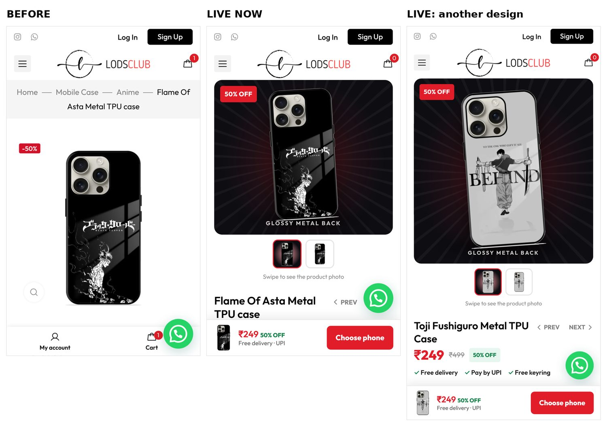

# LodsClub — From cheap clicks to paying customers

**Meta performance marketing + conversion rate optimisation for an Indian D2C anime phone-case brand.**
Freelance project · Oct–Nov 2026 · Role: growth marketer (ads, website, tracking, creative)

🔗 **Visual case study:** https://axankit.github.io/lodsclub-growth-case-study/
🛍️ **Live store:** https://lodsclub.com/anime/



---

## TL;DR

| | Before | After |
|---|---|---|
| Landing page load (mobile) | 9.3 s | **3.1 s** |
| Largest image visible (LCP) | 4.6 s | **2.1 s** |
| Landing page weight | 5.0 MB | **1.8 MB** |
| Paid share of orders with ₹60 shipping | 1 of 31 (3%) | **3 of 7 (43%) with free shipping** |
| Phone-model picker | 126-item dropdown, buried below the fold | Brand tiles + type-to-search, right under the price |
| Ad landing destination | Generic category page (A–Z, no headline) | Dedicated anime landing page + redesigned shop |
| Tracking | Pixel only, no view of where people drop | Full funnel log: page → phone picked → cart → checkout → WhatsApp |

The ads were never the problem. Clicks cost ₹1.79 and people added to cart — **the website lost them**. So the project became: fix every step between the ad click and the UPI payment, then relaunch ads into a funnel that can actually convert.

---

## The problem (diagnosis)

LodsClub sells metal-back TPU phone cases with anime art at ₹249 (MRP ₹499) across 14 phone brands.

- **Ads worked:** best reel → ₹4,137 spend, 182k impressions, 2,066 clicks, CTR 1.26%, **CPC ₹1.79**, 219 add-to-carts, 143 checkouts.
- **Sales didn't:** only **3 purchases** from that traffic.
- **Store data (1 Oct – 11 Nov):** 38 orders created, **4 paid** — 22 cancelled, 11 failed, 1 pending.
- **The shipping signal:** with a ₹60 shipping fee, 1 of 31 orders got paid. With free shipping, 3 of 7.

Root causes found:
1. **Surprise shipping fee** revealed only after the full address at checkout.
2. **Site cache bug** — logged-out mobile visitors were sometimes served the *homepage* instead of the page the ad promised.
3. **Weak product page** — price hidden under the fold, phone picker buried under a features list, Samsung alone = 126 models in one dropdown, one photo, "Reviews (0)".
4. **Slow pages** — 5–7 MB per page, 185 requests, 9 s load on mobile.
5. **No funnel visibility** — impossible to tell where people dropped.

➡️ Full write-up: [case-study/01-diagnosis.md](case-study/01-diagnosis.md)

---

## What I did

| # | Workstream | Highlights | Details |
|---|---|---|---|
| 1 | Checkout & offer | Free delivery until the first 20 orders, UPI-first wording, phone made required, MRP made consistent (₹499) | [02-checkout-and-offer](case-study/02-checkout-and-offer.md) |
| 2 | Anime landing page `/anime/` | Anime-style page with all 73 designs, series navigation, reviews, FAQ; 3× faster | [03-landing-page](case-study/03-landing-page.md) |
| 3 | Shop / category redesign | Live product grid, series filter chips, bestseller sort, mobile-first cards, fixed mobile blank-page bug | [04-category-page](case-study/04-category-page.md) |
| 4 | Product page v2 | Brand tiles, model search, sticky "Buy now" → checkout, trust badges, dark "case view" hero | [05-product-page](case-study/05-product-page.md) |
| 5 | SEO + GEO | Titles, descriptions, OG share images, FAQ + Product schema, answer-ready copy for AI search | [06-seo-geo](case-study/06-seo-geo.md) |
| 6 | Tracking | Visitor Log (Google Sheet + Apps Script): page views, phone picks, carts, checkouts, WhatsApp clicks, UTM per ad | [07-tracking](case-study/07-tracking.md) |
| 7 | Creatives | 15 s vertical reel + two 7-card carousels, all generated in code from product cut-outs | [08-creatives](case-study/08-creatives.md) |
| 8 | Meta campaign | Sales campaign optimised for Purchase, prospecting + retargeting, lifetime budgets, kill rules | [09-meta-campaign](case-study/09-meta-campaign.md) |
| 9 | What's next | Homepage rebuild, shop-by-phone, reviews engine, bundles, site-wide SEO | [10-next-steps](case-study/10-next-steps.md) |

Every change shipped with a **backup and a one-click undo** — see [CHANGELOG.md](CHANGELOG.md).

---

## Repository map

```
├── index.html              → visual case study (GitHub Pages)
├── README.md               → this summary
├── CHANGELOG.md            → every change, date, result, how to undo
├── case-study/             → 10 chapters, one per workstream
├── assets/
│   ├── screenshots/        → before / after proof
│   ├── creatives/          → carousel cards + reel key frames
│   └── video/              → 15 s vertical reel (mp4)
└── code/
    ├── landing-page/       → /anime/ page + SEO head + build script
    ├── category-page/      → shop template, live product loader, FAQ block
    ├── product-page/       → product page v2 (JS + CSS snippet)
    ├── performance/        → PHP rule that strips unused theme assets
    └── creative-generators/→ HTML/Playwright scripts that render the reel + carousels
```

## Stack

Meta Ads Manager · WooCommerce · WordPress / Elementor Pro · PixelYourSite · Google Sheets + Apps Script · Playwright · ffmpeg · Python (Pillow) · Claude (AI assistant for analysis, code and QA)

## Status

Campaign `LC_Anime_Sales_Nov26` is live (₹3,000, 13 → 20 Nov 2026). Results will be added to [09-meta-campaign](case-study/09-meta-campaign.md) when it ends.

> Shared with the client's permission. Account IDs, tracking URLs, phone numbers, emails and customer details are removed.
