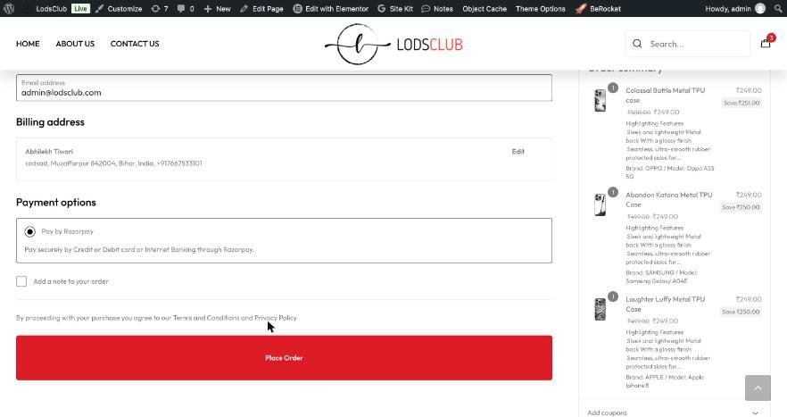

# 01 · Diagnosis — where the money leaked

## Starting point
| Signal | Number |
|---|---|
| First test campaign (May) | ₹2,118 spend · 1,455 link clicks · CPC ₹1.46 · 62 add-to-carts · **2 purchases** · ROAS 0.31 |
| Best reel (Oct–Nov) | ₹4,137 · 182,393 impressions · CTR 1.26% · CPC ₹1.79 · 1,609 landing views · 219 add-to-carts · 143 checkouts · **3 purchases** |
| Store orders 1 Oct–11 Nov | 38 created → **4 paid**, 22 cancelled, 11 failed, 1 pending |
| Shipping test | ₹60 shipping: 1 of 31 paid · Free shipping: 3 of 7 paid |

## Funnel reading
Clicks were cheap and carts were healthy (~10% of landing views). The collapse happened **between checkout and payment**. That points to the website and the offer, not the ads.

## Root causes
1. **Shipping surprise** — "calculated at checkout", revealed after address entry. Single-case buyers (₹249) always paid it.
2. **Cache bug** — the host's page cache keyed incorrectly; some mobile visitors from ads landed on the homepage instead of the promised page. Wrote a plain-language handover for the hosting team; they fixed it.
3. **Product page** — price under the fold on phones, phone picker below a long features list, 126 Samsung models in one dropdown, single photo, "Reviews (0)", inconsistent MRP (₹500 vs ₹499).
4. **Landing page** — ads pointed to a generic category page sorted A–Z, no headline, no offer.
5. **Speed** — 5–7 MB pages, ~185 requests, 9 s full load on mobile.
6. **Blind spots** — pixel only; no way to see which step lost people.

## Decision
Fix the funnel first, relaunch ads second. COD was deliberately ruled out by the client (high RTO risk), so every fix had to make prepaid UPI feel safe and simple.

