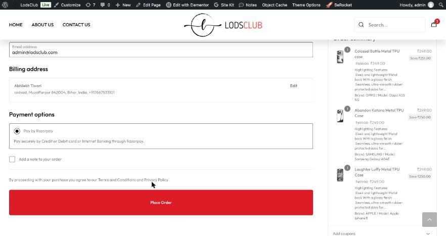
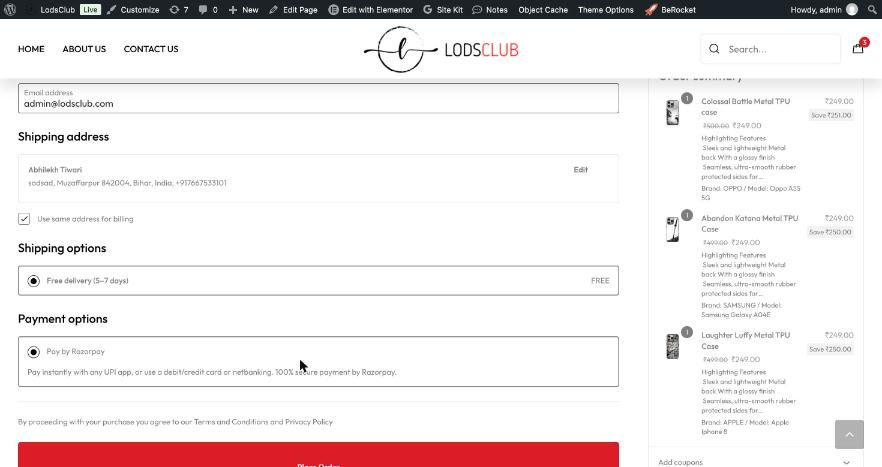

# 02 · Checkout & offer

| Change | Why |
|---|---|
| **Free delivery until the first 20 new orders** | Removes the ₹60 surprise that killed 30 of 31 orders |
| Free delivery shown everywhere *before* checkout (ticker, product page, landing) | No surprises at the last step |
| UPI-first wording on the payment step | Prepaid only — make UPI feel like the default, fast option |
| Phone number required | Couriers need it; fewer failed deliveries |
| MRP fixed to ₹499 on 40 cases | One consistent "₹249 · ₹499 · 50% OFF" story |

| Before | After |
|---|---|
|  |  |
