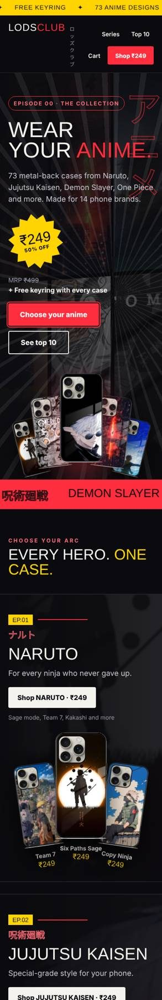
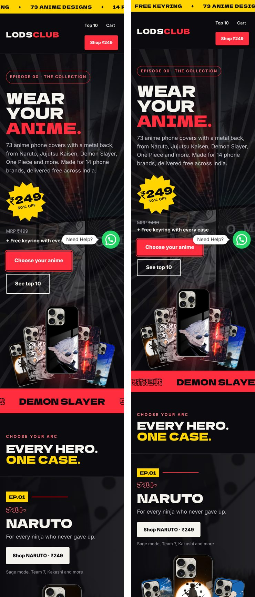

# 03 · Anime landing page — `/anime/`

**Goal:** give ad traffic a page that continues the ad's story: *your anime, on a metal case, ₹249, free delivery.*

## Built
- Anime visual language: dark stage, speed lines, Japanese titles, red/yellow accents, case cut-outs floating on a glow.
- Hero: "WEAR YOUR ANIME." + ₹249 burst + primary CTA.
- Series sections (Naruto, JJK, Demon Slayer, One Piece, Tokyo Revengers, AOT…) using real product cut-outs.
- Google reviews (4.9★) pulled from the homepage, FAQ, WhatsApp button.

## Speed (12 Nov)
WordPress loaded the full theme (1.1 MB stylesheet, sliders, icon packs) on a page that used none of it.
A small PHP rule (`code/performance/fast-landing-page.php`) runs **only on `/anime/`**: keeps the pixel, analytics and WhatsApp, drops everything else, lazy-loads below-the-fold images and preloads the hero.

| Metric (Pixel 7) | Before | After |
|---|---|---|
| Full load | 9.3 s | **3.1 s** |
| LCP | 4.6 s | **2.1 s** |
| Page weight | 5.0 MB | **1.8 MB** |

| Mobile | Before vs after speed fix (design unchanged) |
|---|---|
|  |  |
