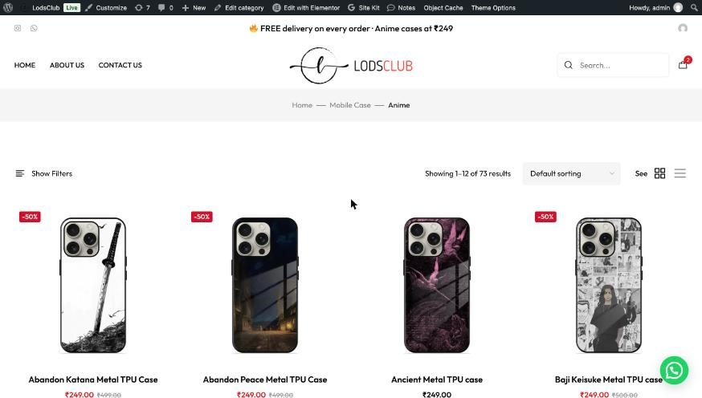
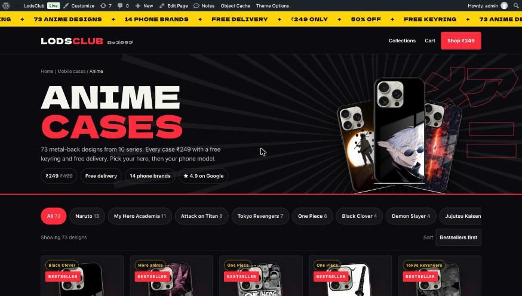
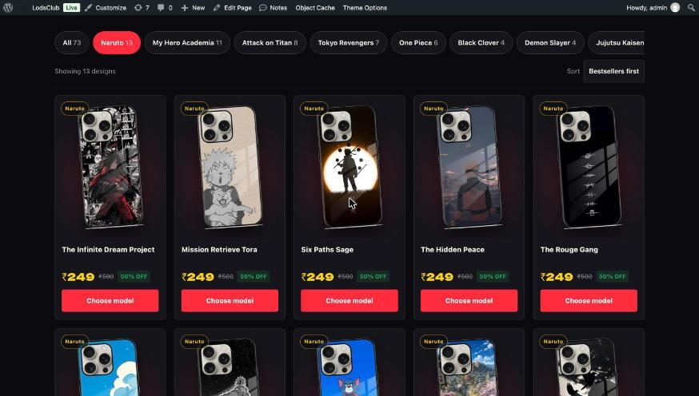
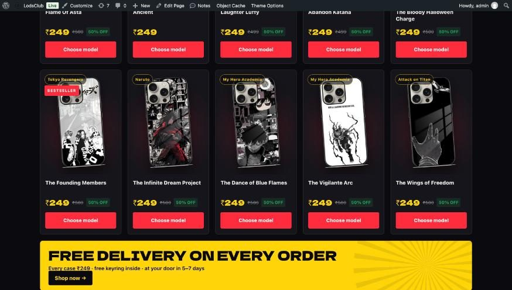
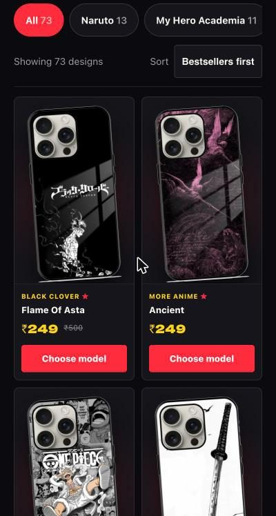

# 04 · Shop / category redesign

The old category page: white grid, A–Z order ("Abandon Katana" first), no headline, 7 pages of pagination.

## New page (Elementor Theme Builder template, live data)
- Anime header with the offer, series **filter chips** with live counts, **bestsellers-first** sort.
- Products load live from the WooCommerce Store API (`code/category-page/live-products.js`) and fall back to static cards if the API fails.
- Clean case cut-outs on a dark stage; card text moved *below* the image after client feedback so the art stays visible.
- Fixed a mobile-only blank page (an Elementor flex widget grew to the ticker width, 2,518 px).

| Before | After |
|---|---|
|  |  |

| Series filter | Grid + promo | Mobile |
|---|---|---|
|  |  |  |
