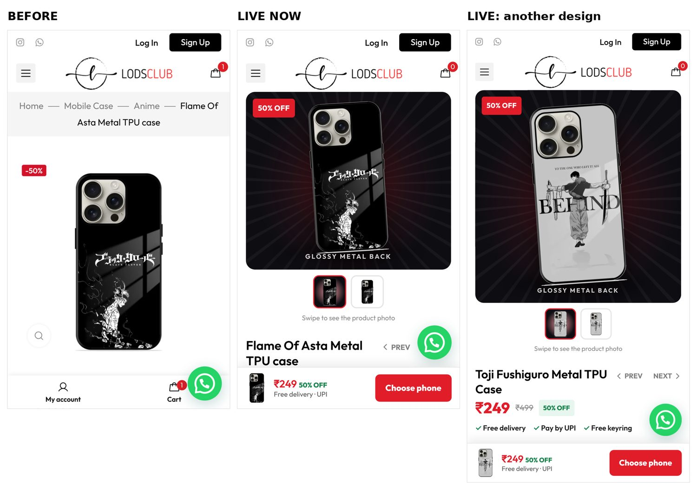
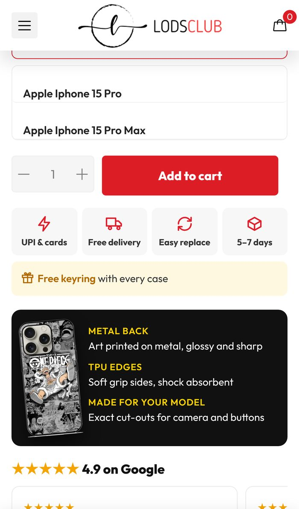
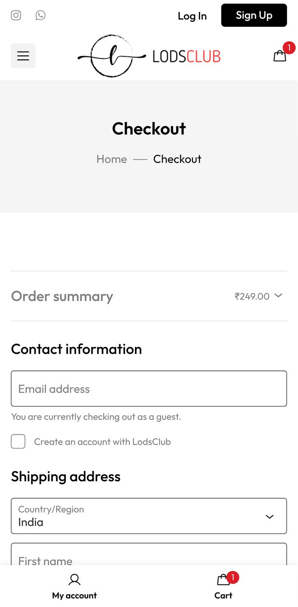

# 05 · Product page v2

**Diagnosis on a phone:** price hidden under the bottom bar, the phone picker two scrolls down, 126 Samsung models in a plain dropdown, one photo, "Reviews (0)", no sticky buy button.

## What changed (one JS/CSS snippet, preview link first, then live)
1. **Price on the first screen** — ₹249, crossed MRP, 50% OFF pill, "Free delivery · Pay by UPI · Free keyring".
2. **Picker right under the price** — brand **tiles** (Samsung, iPhone, Vivo first) → **type-to-search** model list (e.g. "a15"). Can't find your model? Pre-filled WhatsApp message.
3. **Sticky bar** — "Choose phone" until a model is picked, then **Buy now → straight to checkout** (keeps the normal add-to-cart so pixel + tracking still fire).
4. **Trust** — UPI, free delivery, easy replacement, 5–7 days, free keyring; 3 Google reviews; long feature list folded into "Product details".
5. **Case view hero** — the product cut-out on the anime stage (swipe to see the original photo).

Tested end-to-end on iPhone 13 / Pixel 7 / desktop: model saved to the cart line, checkout reached, no JS errors.

| Model search | Checkout (phone required) |
|---|---|
|  |  |

Code: [`code/product-page/product-page-v2.html`](../code/product-page/product-page-v2.html)
