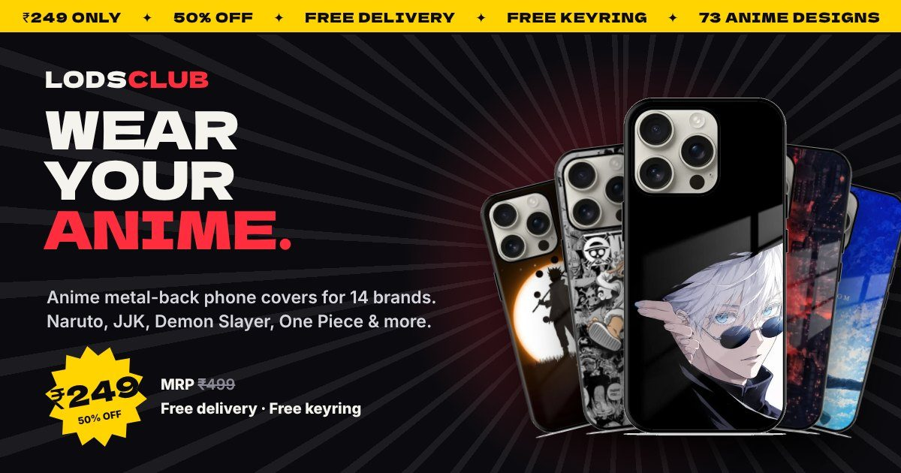
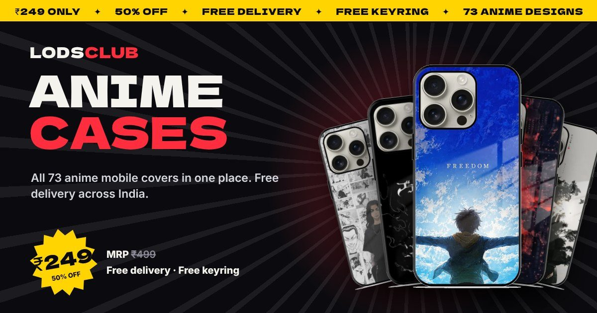
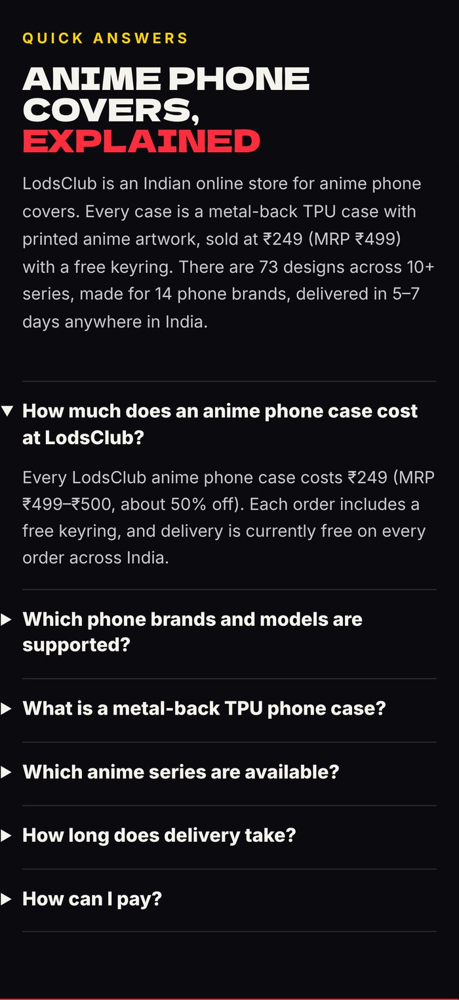

# 06 · SEO + GEO (generative-engine optimisation)

## Done for `/anime/` and the anime category page
- Unique title + meta description, canonical, Open Graph + Twitter cards.
- Custom **share images** (1200×630) so links look right on WhatsApp / Instagram / X.
- **FAQPage** schema + visible FAQ (price, brands, material, delivery, payment).
- "About" paragraph written as a quotable fact block so AI answers (ChatGPT, Perplexity, Google AI Overviews) can cite LodsClub accurately.

| Landing share image | Category share image |
|---|---|
|  |  |

## Site-wide audit (13 Nov) — still to do
- No meta descriptions, no H1 on home / shop / categories, generic titles ("Mobile Case – LodsClub").
- No Organization / WebSite schema, no `llms.txt`, empty blog.
- 0 product reviews → no rich-result stars.
See [10-next-steps](10-next-steps.md).
