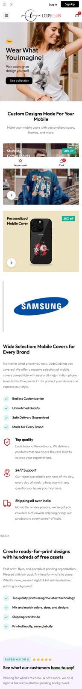

# 10 · What's next — whole-website roadmap

| Priority | Area | Action |
|---|---|---|
| 🔴 | UX / design | Rebuild the homepage around anime cases — today it leads with a T-shirt hero and leftover "flyer printing" demo copy |
| 🔴 | Navigation | Menu has only Home / About / Contact → add Shop, Anime cases, Aesthetic, Find my phone |
| 🔴 | SEO | SEO plugin: titles, descriptions, H1 and OG on every page |
| 🔴 | Flow | **Shop by your phone** — pick the phone first, see every case that fits |
| 🟠 | Trust | Automatic review request after delivery → real stars on product pages |
| 🟠 | AOV | Bundle: 2 cases for ₹449 |
| 🟠 | SEO | Series × phone pages ("Naruto cover for iPhone 15"), buying guides on the blog |
| 🟠 | GEO | Brand-facts + FAQ page with Organization/FAQ schema, `llms.txt` |
| 🟠 | Speed | Apply the `/anime/` asset-stripping approach to home, shop and categories (4–7 MB today) |
| 🟢 | Content | Real in-hand product photos (2–3 per design) |
